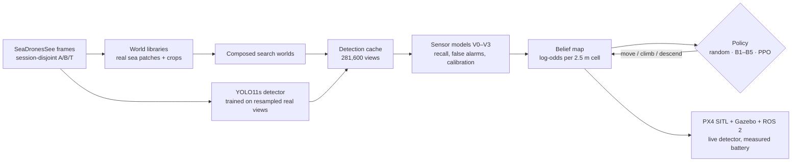
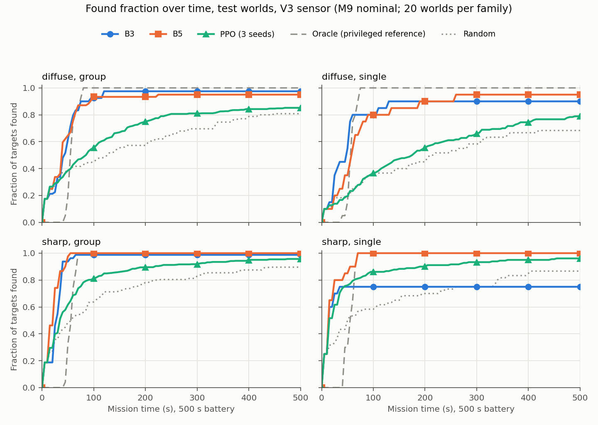
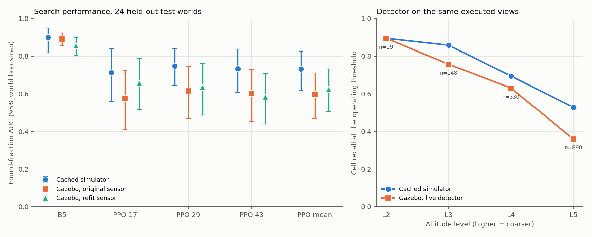

# AltiSeek

**Learning where — and how high — to look for people at sea.**

A simulated drone searches open water for people within a fixed battery budget. Flying high covers
more sea per image but shrinks a person to a few pixels; flying low makes detection reliable but
costs far more battery. AltiSeek studies that tradeoff end to end, from real drone footage to
closed-loop flight in PX4/Gazebo.

Simulation only; no hardware and no real-world performance claims. **All milestones M0–M11 are
complete.** The full write-up is [docs/paper.md](docs/paper.md); the design, data contracts and
decision log (D1–D62) are in [CLAUDE.md](CLAUDE.md).

## Method



1. **Detector.** A small detector is fine-tuned on real
   [SeaDronesSee](https://seadronessee.cs.uni-tuebingen.de/) frames, resampled to the 7.8–23.4 cm/px
   ground sample distances the simulated 640 px camera produces at five altitude levels.
2. **Worlds and cache.** Search worlds are composed from real sea imagery and real object crops, so
   every pixel the detector sees is real imagery. Detections for every reachable view are cached,
   so training never runs the detector.
3. **Sensor model.** Per-level recall, false-alarm rates and calibrated score likelihoods turn
   detections and misses into Bayesian updates.
4. **Policy.** Classical baselines (B1 sweep to B5 lookahead) and masked PPO choose the next move
   from the belief map.
5. **Deployment.** The same code runs closed-loop in PX4 SITL + Gazebo with the detector live on
   the simulated camera.

## Key results

All intervals are 95% whole-world bootstrap intervals on held-out test worlds. Nothing was tuned on
test data.

| Question | Finding |
|---|---|
| **RQ1:** does sensor-model fidelity matter? | Yes. B5's found-fraction AUC rises from 0.677 (naive V0) to 0.903 (altitude-aware, calibrated V3), paired +0.227 [0.162, 0.293]. Altitude-aware binary updates alone (V2) add almost nothing over a pooled model (V1); the gain comes from calibrated score likelihoods. |
| **RQ2:** does PPO beat strong heuristics? | No. PPO trails B5 by −0.160 [−0.198, −0.121] on the nominal test set and in every battery and prior-misspecification scenario. Only distinct-variant re-look helps PPO (+0.085), and it still trails B5. |
| **RQ3:** does the policy survive PX4/Gazebo? | B5 does (−0.008 [−0.069, 0.078]); PPO loses −0.135 [−0.199, −0.073] AUC. Re-fitting the sensor model on 8,800 Gazebo views does not recover the loss (+0.027 [−0.036, 0.096]). |





Detailed results:

| Stage | Result | Acceptance review |
|---|---|---|
| Detector, levels, fidelity (M2–M4) | [docs/results.md](docs/results.md) | [CLAUDE.md §0](CLAUDE.md) |
| Sensor models (M6) | [docs/m6-sensor/sensor-results.md](docs/m6-sensor/sensor-results.md) | D34–D35 |
| Baselines (M7) | [docs/m7-search/baseline-results.md](docs/m7-search/baseline-results.md) | D36–D38 |
| PPO (M8) | [docs/m8-ppo/ppo-auc-results.md](docs/m8-ppo/ppo-auc-results.md) | [docs/m8-ppo/ppo-acceptance.md](docs/m8-ppo/ppo-acceptance.md) |
| Main experiments (M9) | [results](docs/m9-evaluation/m9-results/results.md), [extension](docs/m9-evaluation/m9-extension-results/results.md) | [docs/m9-evaluation/m9-extension-acceptance.md](docs/m9-evaluation/m9-extension-acceptance.md) |
| Calibration and transfer (M10) | [docs/m10-deployment/m10-transfer-results/results.md](docs/m10-deployment/m10-transfer-results/results.md) | [docs/m10-deployment/m10-acceptance.md](docs/m10-deployment/m10-acceptance.md) |

## Setup

Requires [uv](https://docs.astral.sh/uv/) ≥ 0.13.4. Python 3.12 is used locally and in WSL (ROS 2
Jazzy); Kaggle uses Python 3.13. Exact versions are in [docs/setup/env.md](docs/setup/env.md), and the PX4 /
Gazebo / ROS 2 stack is in [docs/setup/deployment.md](docs/setup/deployment.md).

```bash
uv sync         # creates .venv with the pinned dependencies
uv run pytest   # unit tests, plus ruff lint and format checks
```

Datasets, rendered worlds, caches, checkpoints and run outputs live under `data/` and `runs/`, which
are never committed.

## Repository layout

```text
src/altiseek/      the library (geometry, data, detector, world, cache, calibration, belief,
                   env, policies, eval, deploy, registry)
scripts/<stage>/   CLI entry points: data, detector, world, cache, sensor, search, ppo, eval,
                   deploy, figures
configs/           schema-validated YAML; configs/eval/ holds frozen protocols
docs/              write-up, per-milestone protocols, results and reviews (see docs/README.md)
tests/             mirrors src/altiseek
data/, runs/       gitignored datasets, caches, checkpoints and run outputs
```

The full layout is in [CLAUDE.md §6](CLAUDE.md), and [docs/README.md](docs/README.md) indexes every
document.

## Reproducing each stage

Every script reads a config under `configs/`, writes outputs plus a metadata record (commit, config,
package versions, artifact IDs) and is resumable where it runs long. Run from the repository root
as `uv run python scripts/<stage>/<name>.py`.

| Stage | Folder | Entry points |
|---|---|---|
| M1 data | `scripts/data/` | `prepare_data`, `fit_camera`, `make_splits`, `scan_images`, `check_leakage` |
| M2 detector | `scripts/detector/` | `make_views`, `train_detector` (cloud GPU via `kaggle_job`), `eval_detector`, `register_detector` |
| M3–M4 levels and worlds | `scripts/world/` | `design_levels`, `build_libraries`, `generate_worlds`, `check_fidelity` |
| M5 cache | `scripts/cache/` | `build_cache` (cloud GPU), `validate_cache` |
| M6 sensors | `scripts/sensor/` | `fit_sensor_models`, `evaluate_sensor_real`, `report_sensor_models` |
| M7 baselines | `scripts/search/` | `run_baselines`, `report_baselines` |
| M8 PPO | `scripts/ppo/` | `train_ppo`, `run_ppo_suite`, `report_ppo` |
| M9 evaluation | `scripts/eval/` | `evaluate`, `evaluate_extension`, `report_evaluation`, `report_m9_extension` |
| M10 deployment | `scripts/deploy/` | `continue_m10_resilient` (calibration), `review_m10_calibration`, `freeze_m10_transfer`, `launch_m10_transfer`, `report_m10_transfer`, `demo_m10_transfer` |
| M11 figures | `scripts/figures/` | `make_figures` |

Tables and figures regenerate from saved results without rerunning episodes; each milestone's
acceptance review gives its exact commands. Frozen protocols are in `configs/eval/` and the
milestone folders under `docs/`.

**Paths changed on 2026-11-03** when the repository was reorganised (D62). Frozen M9/M10 protocols
hash the earlier flat paths, so verify those artifacts at git tag `results-final`:

```bash
git worktree add ../altiseek-results-final results-final
```

## Limitations

- **Simulation only.** The strongest transfer claim is cached simulator to PX4/Gazebo, with
  ground-truth pose and CPU software rendering.
- **World model.** Nadir camera, flat sea, static targets and composited worlds. Imagery includes
  ground-plane-rectified oblique frames.
- **Data.** Only six capture days underlie the splits, and volunteers may recur across days. Test
  worlds have no distractors, so distractor robustness is tested on B only.
- **Belief.** The belief map assumes independent cells. Calibration remains imperfect.
- **Statistics.** Test sets are small (80 worlds, 24 for live transfer). Comparisons are not
  corrected for multiplicity.

The full list is in [docs/paper.md](docs/paper.md#8-limitations).

## Licence

AltiSeek is licensed under the [GNU Affero General Public License v3.0](LICENSE) (AGPL-3.0-only).
The detector is built on [Ultralytics YOLO](https://github.com/ultralytics/ultralytics)
(`ultralytics==8.4.184`), which is itself AGPL-3.0. PPO uses sb3-contrib (MIT). The
SeaDronesSee dataset is CC0 1.0, and its code is MIT. No dataset imagery, derived imagery, cache or
checkpoint is committed; the demo video stays local because it contains dataset-derived imagery.

## Citation

If you use the data, cite the dataset paper:

> Leon Amadeus Varga, Benjamin Kiefer, Martin Messmer, Andreas Zell. *SeaDronesSee: A Maritime
> Benchmark for Detecting Humans in Open Water.* WACV 2022. [arXiv:2105.01922](https://arxiv.org/abs/2105.01922)

Related work and the remaining references are listed in [docs/paper.md](docs/paper.md#references).
