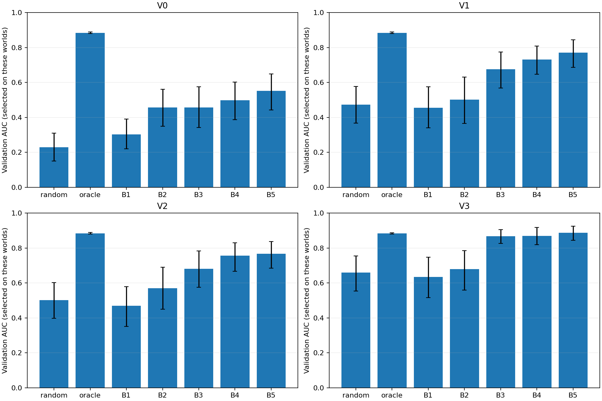

# M7 baseline validation

Run `8cd76bdb72f965a1`; 3,520 episodes; 40 rl-val worlds, five per family. Sensor model `fcf8cdae58ca3947`.

**These are selection-set results, not held-out estimates.** B1-B3 settings were selected per family and sensor variant by validation AUC. The bootstrap intervals resample worlds after selection and do not correct selection bias or shared imagery.

| Sensor | Policy | AUC [95% bootstrap CI] | Found fraction | Success | False declarations | Normalised AUC |
|---|---|---|---:|---:|---:|---:|
| V0 | random | 0.229 [0.150, 0.309] | 0.369 | 0.200 | 4.28 | 0.000 |
| V0 | oracle | 0.884 [0.879, 0.888] | 1.000 | 1.000 | 0.00 | 1.000 |
| V0 | B1 | 0.303 [0.219, 0.391] | 0.444 | 0.250 | 4.25 | 0.113 |
| V0 | B2 | 0.457 [0.349, 0.561] | 0.548 | 0.350 | 3.33 | 0.348 |
| V0 | B3 | 0.457 [0.342, 0.576] | 0.523 | 0.350 | 4.12 | 0.347 |
| V0 | B4 | 0.498 [0.388, 0.603] | 0.598 | 0.400 | 4.88 | 0.410 |
| V0 | B5 | 0.551 [0.443, 0.648] | 0.660 | 0.475 | 4.85 | 0.492 |
| V1 | random | 0.473 [0.367, 0.578] | 0.658 | 0.475 | 2.62 | 0.000 |
| V1 | oracle | 0.884 [0.879, 0.888] | 1.000 | 1.000 | 0.00 | 1.000 |
| V1 | B1 | 0.455 [0.341, 0.576] | 0.546 | 0.425 | 1.32 | -0.045 |
| V1 | B2 | 0.502 [0.366, 0.630] | 0.552 | 0.450 | 1.43 | 0.070 |
| V1 | B3 | 0.676 [0.569, 0.775] | 0.762 | 0.625 | 2.75 | 0.495 |
| V1 | B4 | 0.731 [0.647, 0.807] | 0.873 | 0.725 | 2.98 | 0.628 |
| V1 | B5 | 0.771 [0.686, 0.844] | 0.887 | 0.775 | 2.88 | 0.725 |
| V2 | random | 0.502 [0.398, 0.602] | 0.704 | 0.550 | 2.48 | 0.000 |
| V2 | oracle | 0.884 [0.879, 0.888] | 1.000 | 1.000 | 0.00 | 1.000 |
| V2 | B1 | 0.469 [0.350, 0.579] | 0.577 | 0.450 | 1.23 | -0.086 |
| V2 | B2 | 0.570 [0.450, 0.689] | 0.640 | 0.525 | 1.62 | 0.180 |
| V2 | B3 | 0.681 [0.575, 0.782] | 0.760 | 0.625 | 2.35 | 0.470 |
| V2 | B4 | 0.757 [0.666, 0.829] | 0.875 | 0.775 | 2.90 | 0.668 |
| V2 | B5 | 0.766 [0.685, 0.838] | 0.910 | 0.825 | 2.77 | 0.693 |
| V3 | random | 0.659 [0.554, 0.754] | 0.825 | 0.725 | 2.15 | 0.000 |
| V3 | oracle | 0.884 [0.879, 0.888] | 1.000 | 1.000 | 0.00 | 1.000 |
| V3 | B1 | 0.633 [0.516, 0.748] | 0.694 | 0.550 | 1.23 | -0.114 |
| V3 | B2 | 0.679 [0.560, 0.784] | 0.740 | 0.650 | 1.23 | 0.088 |
| V3 | B3 | 0.868 [0.826, 0.905] | 0.967 | 0.900 | 1.82 | 0.931 |
| V3 | B4 | 0.870 [0.819, 0.917] | 0.965 | 0.900 | 2.42 | 0.939 |
| V3 | B5 | 0.888 [0.844, 0.925] | 0.981 | 0.950 | 2.40 | 1.018 |

Normalisation above uses paired mean oracle/random AUCs over the full validation set for each sensor variant. The oracle is a finest-level perfect-verification reference, not a per-episode upper bound. Family-mean gaps are saved in the JSON.

## Sanity checks

Oracle exceeds random in every family/variant: True (minimum mean AUC gap 0.082).

| Sensor | Fine full-sweep found fraction | Coarse full-sweep found fraction |
|---|---:|---:|
| V0 | 0.408 | 0.069 |
| V1 | 0.417 | 0.175 |
| V2 | 0.504 | 0.150 |
| V3 | 0.544 | 0.525 |

All diagnostic sweeps covered the full lattice or found everyone: True. A 2,000 s budget and 600-step cap make a full fixed-level sweep feasible.

V0 coarse negative observations drove 1 target-cell observations from p >= 0.01 to p < 0.01, including initial observations. Of these, 1 occurred at reset and were omitted by the original step-only diagnostic. Its failed report is retained; a separate check completes the measurement without changing the threshold or rerunning the sweeps. This is weak evidence: 75 of 78 true-target priors already start below 0.01. These do not count as threshold crossings.

Observed environment-plus-logging time: 3.600 ms/step, excluding reset and policy planning; measured with concurrent CPU checks.

The optimized core environment replayed all 320 random/oracle episodes (7,606 steps) without changing saved outcomes. Core step time: mean 1.590 ms, median 1.403 ms, 95th percentile 2.956 ms. This excludes reset, logging and policy planning, so it is not directly comparable to the sweep timing above. The sub-millisecond aim is not met by the full replay; M8 must measure end-to-end training throughput before choosing worker counts.

The PPO zero-belief-channel sanity check belongs to M8, once PPO exists. No test worlds or detector inference were used for M7 validation.

