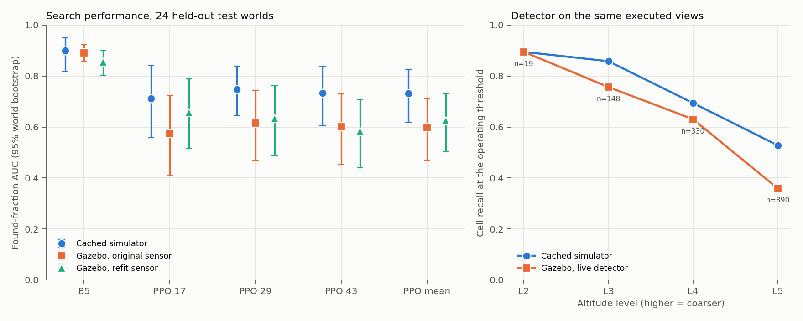

# AltiSeek: Learning Where — and How High — to Look for People at Sea

*A simulation study of altitude-aware sensing, search policies and simulator-to-simulator
transfer. All results are from simulation; no real-world performance is claimed.*

## Abstract

A drone searching open water for people in the sea faces an altitude tradeoff. High views cover
more sea but shrink a swimmer to a few pixels, while low views detect reliably but cost far more
battery. We study this tradeoff end to end in simulation:

- a small detector is fine-tuned on real drone footage (SeaDronesSee) at the resolutions a
  simulated camera produces;
- search worlds are composed from real sea imagery and real object crops;
- an explicit, altitude-aware sensor model turns detections and misses into Bayesian updates of a
  probability map;
- a policy chooses horizontal moves, climbs and descents under a fixed battery.

We compare four sensor models, five classical baselines and masked PPO on 80 held-out test worlds.
We then run the pipeline closed-loop in PX4 SITL and Gazebo with a live detector.

Sensing fidelity matters most. With the strongest heuristic (B5, depth-two lookahead),
score-aware V3 updates raise found-fraction AUC from 0.677 under a naive model to 0.903. The
paired gain is 0.227, 95% CI [0.162, 0.293]. PPO trails B5 in every setting: −0.160
[−0.198, −0.121] on the nominal test set, and more under perturbations. In 192 live PX4/Gazebo
episodes on 24 held-out worlds, B5 transfers with no resolved AUC loss (−0.008
[−0.069, 0.078]). PPO loses 0.135 [0.073, 0.199]. Re-fitting the sensor model on 8,800 Gazebo
views does not recover that loss (+0.027 [−0.036, 0.096]). We report these negative results as
found, with their limitations.

## 1. Introduction

Unmanned aerial search for people in the water is a sensing problem as much as a planning one.
The camera's footprint grows linearly with altitude, but the swimmer's apparent size shrinks with
it. Detectors that are reliable at 8 cm per pixel miss many targets at 23 cm per pixel. A search
policy therefore has to choose where to look next, and how high. Whether it can choose well depends
on how faithfully its belief reflects what the detector can and cannot see from each altitude.

This project builds and evaluates that full loop: real imagery, a trained detector, an explicit
sensor model, a belief map and a policy, followed by a closed-loop deployment test. It asks three
questions:

- **RQ1. Does sensor-model fidelity matter for search?** We compare four ways of converting
  detections into belief updates, from a naive model that treats scores as probabilities to an
  altitude-aware model with calibrated score likelihoods.
- **RQ2. When does a learned policy beat strong heuristics that use identical sensing?** We
  compare masked PPO with five classical baselines, under a battery sweep and prior
  misspecification. We also run the PPO design ablations.
- **RQ3. Does the policy survive the move from cached detections to a live detector in
  PX4/Gazebo?** We also ask whether re-fitting the sensor model on Gazebo views closes the gap.

The contributions are:

1. an end-to-end, leakage-controlled pipeline from SeaDronesSee frames to a cached-detection search
   environment;
2. altitude-aware sensor models with measured recall, false-alarm rates and calibration;
3. a frozen, paired evaluation of classical and learned policies;
4. a simulator-to-simulator transfer study with pre-registered protocols and a refit arm.

The study is designed to report negative results. Several of its central hypotheses are not
supported.

## 2. Related work

**Detection at sea.** SeaDronesSee (Varga et al., 2022) provides drone footage of people in open
water with altitude metadata; we use its Object Detection v2 release. Altitude-aware tiling for
maritime small objects (arXiv:2511.19728) and sliced inference (SAHI; Akyon et al., 2022) address
the same small-object problem from the detector side. We instead keep the detector fixed and model
its altitude dependence explicitly.

**Informative path planning and target search.** Meera et al. (2019) plan UAV target search with
height-dependent sensor performance. Rückin et al. (2022) use deep RL for adaptive informative
path planning, and graph-based RL extends this (arXiv:2402.04894). A recent survey covers
learning-based adaptive IPP (arXiv:2404.06940). Classical maritime search patterns (expanding
square, sector, parallel track) are standardised in the IAMSAR Manual. Our B1–B2 baselines follow
them, and B3–B5 add belief-driven confirmation and lookahead.

**Calibration.** Temperature scaling (Guo et al., 2017) and multivariate detector calibration
(Küppers et al., 2020) address whether detection scores are probabilities. We keep calibration
separate from the sensor model: calibration alone says nothing about misses, which drive negative
evidence in search.

**Reinforcement learning.** We use PPO (Schulman et al., 2017) with invalid-action masking (Huang &
Ontañón, 2022). Optional shaping is potential-based (Ng et al., 1999) to avoid farmed rewards.

## 3. Data and detector

**Data.** We use only labelled SeaDronesSee ODv2 images from the 3840×2160 quadcopter camera,
the one group with a fitted camera model. Its focal length was fitted from the open-sea horizon:
f = 3029 px, horizontal field of view 64.7° (D12). Oblique frames are used through a tilted
pinhole model over a flat sea, rectified into nadir-equivalent views (D14). A session is one
capture day across all cameras (D15). Splits are session-disjoint:

- **A** (detector training): Lake Constance 2020 plus 2021-08-20.
- **B** (sensor fitting, RL training and validation): 2021-08-21.
- **T** (test only): 2021-08-19.

B and T come from the open-sea campaign (D16). A three-test near-duplicate check passed before any
training (D17). It uses perceptual hash, thumbnail correlation and ORB/RANSAC inliers, with
thresholds set only on pairs of known status.

**Detector.** YOLO11s (Ultralytics 8.4.184) is fine-tuned on real A frames only. They are
resampled to target ground sample distances (GSDs) drawn evenly across 2–30 cm/px. Training never
uses pasted composites, and copy-paste, mosaic and scale augmentation are disabled, because they
would change the GSD (D21, D23). The selected detector `700e0ff3455259e8` reaches internal
validation mAP50 0.613. On real B frames, swimmer centre recall (a detection within 1 m) falls from
0.87 at 7.8 cm/px to 0.65 at 23.4 cm/px. This decline is the premise of the study
([figure](figures/eval_vs_gsd_700e0ff3_d25.png)).

**Camera and levels.** The simulated camera models the detector's input resolution, 640×640 px
with an 80° field of view, not the original 4K sensor. Five levels tile a 300 m area of 2.5 m
cells exactly (D7):

| Level | Footprint | Altitude | GSD | Centre recall (B) | Full sweep |
|---|---|---|---|---|---|
| L1 | 50 m | 29.8 m | 7.8 cm/px | 0.87 | 542 s |
| L2 | 75 m | 44.7 m | 11.7 cm/px | 0.81 | 278 s |
| L3 | 100 m | 59.6 m | 15.6 cm/px | 0.75 | 170 s |
| L4 | 120 m | 71.5 m | 18.8 cm/px | 0.71 | 122 s |
| L5 | 150 m | 89.4 m | 23.4 cm/px | 0.65 | 78 s |

The battery is 500 hover-equivalent seconds. A full L1 sweep is infeasible, and a full L5 sweep is
cheap. Recall at the coarsest level stays well above the originally intended ≤ 0.3, because the
measured curve is shallow. We accepted a looser coarse-level rule (≤ 0.65) and record it as a
design limitation.

## 4. Simulator, cache and sensor models

**Worlds.** A world is a specification, not an image. Sea patches and object crops come from
separate B and T libraries, using pixels within 45° of nadir at 5 cm/px (D26, D27). They are
composited with seam blending and colour harmonisation. Each target swimmer is drawn from an
anisotropic Gaussian prior, single or in a group of 2–4, with distractors where the library allows
(D28, D29).

Fidelity was accepted on a paste test (D30): library swimmers pasted into real frames are detected
within 0.10 of the real swimmers beside them at every level, on B and T. Glint scenes were excluded
after they rendered poorly. T has no usable distractor crops, so **test worlds contain no
distractors** (D43).

**Detection cache.** We cached detector outputs for every reachable view (281,600 views over 320
worlds) on cloud GPUs. 6,400 sampled views were re-run live and matched the cache within fixed
tolerances (D31–D33). RL training and evaluation never run the detector.

**Sensor models (D34, D35).** Recall r_ℓ and false-alarm rate f_ℓ are measured per level on 40
sensor-fit B worlds, as cell events. A cell counts as detected if the maximum swimmer score among
detections centred in it clears a threshold. Four variants share one log-odds interface:

| Variant | Positive evidence | Negative evidence |
|---|---|---|
| V0 naive | p′ = max(p, raw score) | fixed recall 0.9, f = 0 |
| V1 global binary | r/f pooled over levels | (1−r)/(1−f) pooled |
| V2 altitude binary | r_ℓ / f_ℓ | (1−r_ℓ)/(1−f_ℓ) |
| V3 altitude soft | r_ℓ·p(s\|swimmer, ℓ) / f_ℓ·p(s\|empty, ℓ), calibrated score histograms | as V2, at the lower retained threshold |

Cell recall on sensor-fit B is 0.794, 0.797, 0.780, 0.664 and 0.446 for L1–L5. The false-alarm
rate is about 3–4 per 10,000 empty cells ([figure](figures/m6_rates.png)).

Per-level temperature scaling improves calibration only slightly, and expected calibration error
(ECE) stays at 0.16–0.29 in-sample and higher on held-out data
([figure](figures/m6_reliability.png)). The detector is deterministic, so a second look from the
same level after a miss succeeds only 10–19% of the time. Only the first observation per cell and
level therefore updates the belief.

**Belief and environment (D36–D38).** The belief starts at p = 1 − (1 − q)^K, from the given
prior q and the known target count K, assuming cell independence. Cells whose belief exceeds 0.5
are auto-declared and verified against ground truth, as a rescue boat would. The action space is
four lattice moves plus ascend and descend, with masks. Energy charges horizontal and vertical
travel, a 2 s dwell per view and a 1.5× climb multiplier.

## 5. Policies

All policies see the same observation and masks; only the oracle sees ground truth.

- **Random** chooses a uniformly random valid action.
- **Oracle** flies a short tour visiting each target cell at L1, with perfect verification. It is
  a privileged reference, not an upper bound: a lucky coarse find can beat it, so normalised
  scores can exceed one (D37).
- **B1** is a boustrophedon sweep at one level.
- **B2** is a sweep ordered by prior mass.
- **B3** scans high and confirms low.
- **B4** is greedy expected information gain per unit energy.
- **B5** is depth-two lookahead on the same objective.

Every baseline hyperparameter was selected on 40 B validation worlds only, per family and sensor
variant (D37, D38).

**PPO.** We use MaskablePPO (sb3-contrib 2.9.2) with a custom CNN over the map channels:
belief, prior, per-level coverage, resolved cells, footprint, position and coordinates. Its output
is concatenated with vector features (level, battery, time, found fraction, K).

The first configuration failed diagnosably (D40): its energy-penalised reward ranked
trajectories opposite to the evaluation metric. The accepted objective (D41) rewards each find
with the remaining battery fraction divided by K, with γ = 1. Its return equals the found-fraction
AUC.

Each configuration was trained on CPU for 131,072 steps per seed with three seeds (17, 29, 43),
and the checkpoint was selected on B validation AUC. M8 was accepted with qualifications (D42).
Validation AUC was 0.720 (V3) and 0.212 (V0), against B5's 0.888 and 0.551. Stable V0 convergence
was not demonstrated. An original diagnostic gate, the zero-belief comparison, failed and is kept
in the record.

## 6. Evaluation protocol

Protocols were frozen before any test run (D44, D47, D56). Results use 80 T worlds, 10 per
original family. They pool into four actual prior/target families, because T's distractor labels
are not density contrasts.

The metric is found-fraction AUC over the battery, which rewards finding early. Intervals are 95%
whole-world bootstrap intervals. PPO's three seeds are averaged within each world, and seed spread
is reported separately. Comparisons are paired on shared seeds and not corrected for multiplicity.
Nothing was tuned on T.

## 7. Results

### 7.1 RQ1: sensor-model fidelity

Nominal test AUC [95% CI]:

| Policy | V0 naive | V1 global | V2 altitude | V3 soft |
|---|---|---|---|---|
| B3 | 0.569 [0.478, 0.654] | 0.597 [0.502, 0.686] | 0.614 [0.521, 0.704] | 0.847 [0.785, 0.903] |
| B4 | 0.626 [0.546, 0.699] | 0.828 [0.776, 0.874] | 0.831 [0.776, 0.880] | 0.894 [0.855, 0.926] |
| B5 | 0.677 [0.605, 0.745] | 0.833 [0.783, 0.878] | 0.838 [0.785, 0.883] | 0.903 [0.867, 0.933] |
| PPO | 0.242 [0.199, 0.289] | — | — | 0.744 [0.689, 0.798] |

For B5, the paired gains over V0 are:
- V1: +0.157 [0.098, 0.221]
- V2: +0.162 [0.101, 0.225]
- V3: +0.227 [0.162, 0.293]

Fidelity clearly matters: the naive model is far worse for every policy.

**H1a is only partly supported.** Altitude-aware binary updates (V2) match the pooled model (V1)
within 0.005 AUC for every baseline. The gain over V1 comes from V3's calibrated score
likelihoods. The pooled and per-level rates are similar enough at the operating threshold that
altitude awareness alone adds little here.

**H1b's predicted failure modes appear only weakly.** V0 false clears are rare at 0.04 per B5
episode, and V0 false declarations are not elevated: 0.06 per episode under V0 against 0.15 under
V3. V0 fails instead through slow, uninformative search, as its low AUC shows.

### 7.2 RQ2: learned policy versus heuristics

PPO is below B5 on the nominal test set under both sensor variants it was trained on:
- V3: −0.160 [−0.198, −0.121]
- V0: −0.434 [−0.489, −0.377]

The gap holds in every V3 scenario:

| V3 scenario | PPO AUC | B5 AUC |
|---|---|---|
| 250 s battery | 0.628 | 0.832 |
| 500 s battery | 0.744 | 0.903 |
| 750 s battery | 0.799 | 0.927 |
| Prior shifted 50 m | 0.616 | 0.871 |
| Prior rotated 90° | 0.710 | 0.870 |
| Prior spread doubled | 0.684 | 0.898 |

The per-family curves ([figure](figures/m11_found_curves.png)) show the source of the gap:

- PPO keeps pace with the heuristics early only in the sharp-prior families.
- Under diffuse priors PPO stays only slightly above random search for the first 100 s, while
  B3 and B5 reach about 0.8 within about 100 s.
- B3 stalls at 0.75 on sharp single targets, where B5 reaches 1.0.

**H2, that PPO wins when the battery is tight or the prior structured, is not supported.**

**Ablations.** These are V3 PPO, each against its own control:

| Ablation | AUC change from control [95% CI] |
|---|---|
| Distinct-variant re-look | +0.085 [0.058, 0.113] |
| Egocentric map | +0.022 [−0.006, 0.048] |
| Unknown K | −0.010 [−0.036, 0.015] |
| Potential shaping | −0.009 [−0.028, 0.012] |
| Learned DECLARE | −0.122 [−0.170, −0.073] |

- Re-look still trails B5 by 0.079 [0.044, 0.115]. It relies on an optimistic
  independence assumption across distinct variants, so it was not promoted after seeing T.
- Learned DECLARE averages 57 false declarations per episode, because the AUC objective does not
  penalise them.

**Robustness.** Frozen PPO degrades sharply under perturbations, even with sensor models re-fitted
on B:
- Detector swap: −0.155 [0.107, 0.209].
- Halving camera resolution to 320 px: −0.577 [0.529, 0.629].

B5 degrades less: 0.881 and 0.686 against 0.903. On a separate B-only distractor stress test,
PPO's AUC is unchanged, but its false declarations rise from 0.65 to 8.26 per episode.

### 7.3 RQ3: PX4/Gazebo transfer

**Setup.** PX4 v1.17.0 SITL flies an x500 quadrotor in Gazebo Harmonic with ROS 2 Jazzy. A nadir
640×640 camera views the exported world texture. The detector, belief, policy and supervisor share
the same code as the simulator and run co-located on the CPU-only host (D52).

Execution is stop-and-shoot:
- the vehicle settles within 0.5 m, 0.3 m/s, 1° and 2° for 2 s;
- images must match a measured pose within 0.04 s, and the camera must be within 1 m of the goal;
- only fully visible cells update the belief.

Every interval of simulator time is charged to the measured battery, including settling, inference
and decisions. Pose is Gazebo ground truth.

**Gazebo-refit sensor.** All 40 sensor-fit B worlds were flown at every lattice view: 8,800 views
from 48 flights, with failed flights deferred and retried (D53–D55). An independent audit
reproduced the refit model `caba50dfc568562d` exactly. Gazebo recall matches cached recall at fine
levels but falls faster with altitude: 0.263 against 0.446 at L5.

**Study (protocol v4 `5560516d08907341`).**
- 24 T worlds selected by metadata hash, three per original family.
- B5 and all three PPO seeds, each with the original and the refit sensor: 192 live episodes.
- 96 cached references with identical seeds.
- A preflight on B ran first.

Three earlier protocol versions were superseded by operational fixes before or during execution.
Every case was then re-flown under one identity (D56–D58).

Five live attempts ended in telemetry-confirmed stale-telemetry landings; each was re-flown and
completed. Three rejected captures were successfully recaptured.

| Policy | Cached | Live, original | Live, refit | Live − cached | Refit − original |
|---|---|---|---|---|---|
| B5 | 0.899 | 0.891 | 0.856 | −0.008 [−0.069, 0.078] | −0.036 [−0.073, −0.010] |
| PPO (3 seeds) | 0.731 | 0.597 | 0.624 | −0.135 [−0.199, −0.073] | +0.027 [−0.036, 0.096] |

**H3a.** B5 transfers with no resolved loss and finds every target in all 24 worlds live. PPO loses
AUC for every seed, and its first finds come about 62 s later. Two contributors are visible, but
they are not isolated:

1. **Detector shift.** On the same executed lattice views, live L5 recall is 0.360 against 0.528
   cached (difference CI [−0.283, −0.041]). L3 and L4 are lower too, though their intervals
   include zero.
2. **Measured-time overhead (post-hoc).** A live step costs about 1.65× the cached nominal energy:
   B5 17.6 against 10.2 s, PPO 16.0 against 9.6 s. B5 needs a median of 4 steps and PPO 11–12, so
   the overhead hurts PPO more.

**H3b is not supported.** The refit sensor does not recover PPO's loss: the recovered fraction is
0.20 [−0.38, 0.70]. It slightly hurts B5, delaying first finds by 17 s. It does reduce PPO false
declarations, by 0.083 [0.014, 0.167] per episode. The refit inherits the weaknesses of its
calibration data: one view per location, poor calibration (ECE 0.18–0.32), and temperatures at the
fit bound for L2 and L3.

## 8. Limitations

- **Simulation only.** The strongest transfer claim is cached simulator to PX4/Gazebo. Gazebo uses
  ground-truth pose and CPU software rendering. No hardware was flown.
- **World model.** The camera is nadir with fixed yaw, the sea is flat, targets are static and
  worlds are composited from real crops. Imagery includes ground-plane-rectified oblique frames,
  where 3D objects lean and reflections differ.
- **Data.** Splits rest on only six capture days, and the same volunteers may appear on several
  days. T has no distractors, so distractor robustness is tested only on B. Glint was excluded.
- **Belief.** The belief assumes cell independence. Calibration remains imperfect, and second-look
  recall was measured only in cache.
- **Statistics.**
  - Test sets are small: 80 worlds in M9, 10 per family, and 24 in M10, with one live action draw
    per case.
  - Per-family results are descriptive, and the many comparisons are not corrected for
    multiplicity.
- **Reference and training.**
  - The oracle is a privileged reference, not a bound.
  - PPO training was budget-limited, and V0 convergence was not demonstrated.
  - The coarse-level recall rule was loosened to fit the measured detector curve (D7).
- **Deployment stack.** Five stale-telemetry landings in about 200 live flights show the stack is
  not fully stable. The likely cause is brief CPU-only simulator stalls, but this is unproven.

## 9. Conclusion

Across cached and live simulation, **sensing fidelity matters more than the planner's capacity to
learn**. Score-aware, altitude-specific sensor models gave the largest improvement in this study.
A strong lookahead heuristic using those models beat masked PPO in every scenario we tested, and
it held its performance when moved into closed-loop PX4/Gazebo flight. PPO did not.

Re-fitting the sensor model on Gazebo views did not close PPO's deployment gap. The practical
lesson is to budget for sensor-model quality and deployment-time accounting before policy
learning. Natural next steps:
- more live draws;
- a time-accounting ablation that separates perception from execution overhead;
- a refit with repeated views per location, to measure second-look recall.

Each needs a new protocol with B-only design choices.

## Reproducibility

Each stage has a script in `scripts/` and a frozen protocol in `configs/eval/` or `docs/`. Every
table and figure regenerates from saved results:

- `scripts/report_evaluation.py` and `scripts/report_m9_extension.py` for M9;
- `scripts/report_m10_transfer.py` for M10;
- `scripts/make_figures.py` for the M11 figures.

Data, caches, checkpoints and imagery are never committed. Design, decisions (D1–D60) and
acceptance reviews are in `CLAUDE.md` and `docs/`.

## References

- Akyon, Altinuc, Temizel. *Slicing Aided Hyper Inference and Fine-tuning for Small Object
  Detection.* ICIP 2022.
- Guo, Pleiss, Sun, Weinberger. *On Calibration of Modern Neural Networks.* ICML 2017.
- Huang, Ontañón. *A Closer Look at Invalid Action Masking in Policy Gradient Algorithms.* FLAIRS
  2022.
- IMO/ICAO. *IAMSAR Manual, Vol. II.*
- Küppers, Kronenberger, Shantia, Haselhoff. *Multivariate Confidence Calibration for Object
  Detection.* CVPR Workshops 2020.
- *Maritime Small Object Detection from UAVs using Deep Learning with Altitude-Aware Dynamic
  Tiling.* arXiv:2511.19728.
- Meera, Popović, Millane, Siegwart. *Obstacle-aware Adaptive Informative Path Planning for
  UAV-based Target Search.* ICRA 2019. arXiv:1902.10182.
- Ng, Harada, Russell. *Policy Invariance Under Reward Transformations.* ICML 1999.
- Rückin, Jin, Popović. *Adaptive Informative Path Planning Using Deep Reinforcement Learning for
  UAV-based Active Sensing.* ICRA 2022. arXiv:2109.13570.
- Schulman et al. *Proximal Policy Optimization Algorithms.* 2017.
- Varga, Kiefer, Messmer, Zell. *SeaDronesSee: A Maritime Benchmark for Detecting Humans in Open
  Water.* WACV 2022. arXiv:2105.01922.
- *Deep Reinforcement Learning with Dynamic Graphs for Adaptive Informative Path Planning.*
  arXiv:2402.04894.
- *Learning-based Methods for Adaptive Informative Path Planning* (survey). arXiv:2404.06940.
