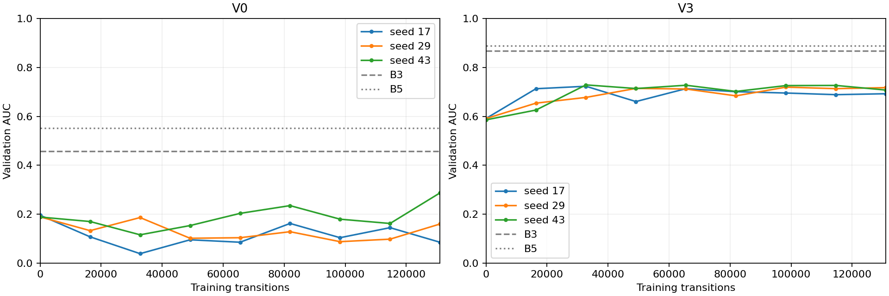

# M8 PPO validation

Completed training runs: 6/6.

These are checkpoint-selection results on B, not held-out test performance. All training seeds are reported. Paired intervals resample worlds after selection; they do not correct selection bias or shared imagery.
Primary action rule: sampled; 3 draw(s) per world. Repeated draws are averaged within worlds for paired intervals.

| Variant | Seed | Selected step | AUC | Found | All found | False declarations | Zero-p AUC | Zero-p minus B2 |
|---|---:|---:|---:|---:|---:|---:|---:|---:|
| V0 | 17 | 81920 | 0.162 | 0.265 | 0.183 | 3.49 | 0.147 | -0.310 |
| V0 | 29 | 32768 | 0.186 | 0.285 | 0.192 | 3.68 | 0.184 | -0.273 |
| V0 | 43 | 131072 | 0.287 | 0.421 | 0.283 | 3.85 | 0.242 | -0.215 |
| V3 | 17 | 65536 | 0.713 | 0.846 | 0.758 | 2.01 | 0.658 | -0.021 |
| V3 | 29 | 98304 | 0.719 | 0.873 | 0.800 | 2.11 | 0.704 | +0.025 |
| V3 | 43 | 65536 | 0.727 | 0.859 | 0.733 | 1.83 | 0.644 | -0.035 |

## Action rule and search efficiency

Argmax uses the checkpoint selected by sampled actions; it is not reselected.

| Variant | Seed | Sampled AUC | Argmax AUC | Repeat fraction | No-information fraction |
|---|---:|---:|---:|---:|---:|
| V0 | 17 | 0.162 | 0.006 | 0.538 | 0.555 |
| V0 | 29 | 0.186 | 0.074 | 0.442 | 0.474 |
| V0 | 43 | 0.287 | 0.136 | 0.420 | 0.449 |
| V3 | 17 | 0.713 | 0.533 | 0.243 | 0.273 |
| V3 | 29 | 0.719 | 0.629 | 0.212 | 0.235 |
| V3 | 43 | 0.727 | 0.534 | 0.275 | 0.316 |

## Across-seed comparison

| Variant | Completed seeds | Mean AUC | Seed standard deviation | B3 AUC | B5 AUC |
|---|---:|---:|---:|---:|---:|
| V0 | 3 | 0.212 | 0.066 | 0.457 | 0.551 |
| V3 | 3 | 0.720 | 0.007 | 0.868 | 0.888 |

Zero-belief diagnostic gate: False. A positive zero-p minus B2 triggers investigation; it must not be silently accepted.

| Variant | Seed | Zero-p minus B2, 95% CI | Full p minus zero-p, 95% CI |
|---|---:|---|---|
| V0 | 17 | -0.310 [-0.412, -0.211] | +0.015 [-0.031, +0.060] |
| V0 | 29 | -0.273 [-0.390, -0.168] | +0.002 [-0.005, +0.011] |
| V0 | 43 | -0.215 [-0.320, -0.121] | +0.046 [+0.016, +0.078] |
| V3 | 17 | -0.021 [-0.109, +0.068] | +0.055 [+0.016, +0.096] |
| V3 | 29 | +0.025 [-0.089, +0.143] | +0.015 [-0.036, +0.074] |
| V3 | 43 | -0.035 [-0.136, +0.071] | +0.083 [+0.023, +0.145] |

## Behaviour and stability

| Variant | Seed | Mean first find (s) | Seconds at L1/L2/L3/L4/L5 | Immediate descents / coarse detections | Final three AUC range |
|---|---:|---:|---|---:|---:|
| V0 | 17 | 382.7 | 166.6/68.3/59.1/80.2/70.9 | 135/1061 | 0.060 |
| V0 | 29 | 365.8 | 192.7/89.3/52.2/49.3/46.0 | 167/670 | 0.072 |
| V0 | 43 | 298.2 | 209.3/75.1/39.7/38.9/38.1 | 148/551 | 0.125 |
| V3 | 17 | 113.3 | 6.0/11.6/22.1/54.6/92.4 | 193/955 | 0.007 |
| V3 | 29 | 112.3 | 29.6/26.3/32.8/44.9/52.7 | 156/640 | 0.006 |
| V3 | 43 | 103.2 | 8.5/8.1/24.7/60.8/94.5 | 147/1150 | 0.019 |
| V0 B3 | — | 202.8 | 16.8/20.1/22.0/188.4/95.1 | not logged in M7 | — |
| V3 B3 | — | 48.4 | 0.2/9.2/9.6/72.4/8.5 | not logged in M7 | — |

First-find times are censored at 500 s. Coarse-detection counts use raw cached views, including resolved/suppressed detections. The final-three range describes curve variation; it is not a convergence proof. Optimizer finiteness and per-world metrics are in the JSON; full trajectories remain in the local run archive.

The zero-p diagnostic retains prior, coverage, resolved cells and vector inputs. It is an input-removal check, not a separately trained prior-only policy.

