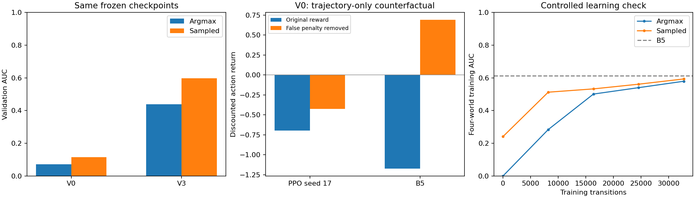

# M8 failure diagnosis

The initial configuration has multiple demonstrated failure mechanisms. The reward ranks weak V0 search above strong search; deterministic action selection reduces coverage; per-decision discounting favors splitting energy expenditure into more actions. These findings do not fully explain the remaining V3 gap or establish an architecture defect.

All six checkpoints and original results are preserved. Evidence: 240 exact deterministic replays, 720 sampled-action episodes, 1,783 input probes, and a separate 32,768-step four-world learning check. Only B worlds were used.

## 1. Action selection causes a measurable evaluation loss

| Sensor | Argmax AUC | Sampled AUC | Paired increase [95% world bootstrap CI] |
|---|---:|---:|---|
| V0 | 0.072 | 0.116 | +0.043 [+0.003, +0.086] |
| V3 | 0.439 | 0.597 | +0.158 [+0.101, +0.215] |

Each sampled estimate averages three action seeds per world and all three training seeds. The interval resamples the 40 paired worlds after averaging training/action seeds; it does not capture all training uncertainty or selection bias. V3 sampled AUC still trails frozen random (0.659) and B5 (0.888). Sampling improves coverage but does not rescue the learned policy. This does not replace the frozen deterministic M8 result.

## 2. The reward conflicts with the selection metric

| Sensor | Policy | AUC | Discounted action return | Same trajectory, false penalty removed |
|---|---|---:|---:|---:|
| V0 | PPO seed 17 | 0.085 | -0.698 | -0.425 |
| V0 | PPO seed 29 | 0.077 | -0.678 | -0.452 |
| V0 | PPO seed 43 | 0.055 | -0.745 | -0.533 |
| V3 | PPO seed 17 | 0.444 | -0.028 | 0.047 |
| V3 | PPO seed 29 | 0.433 | -0.186 | 0.023 |
| V3 | PPO seed 43 | 0.439 | -0.143 | -0.006 |
| V0 | random | 0.229 | -1.571 | -0.083 |
| V0 | B3 | 0.457 | -1.014 | 0.501 |
| V0 | B5 | 0.551 | -1.173 | 0.691 |
| V3 | random | 0.659 | -0.060 | 0.774 |
| V3 | B3 | 0.868 | 0.446 | 1.210 |
| V3 | B5 | 0.888 | 0.286 | 1.303 |

Returns exclude reset rewards because they precede the first policy action. The same paired launch makes those initial observations identical across normal policies. All three V0 PPO seeds earn better discounted returns than B3/B5, despite finding far fewer targets. Removing only the false-declaration term from saved trajectories reverses that ranking. This isolates the penalty's contribution to the objective mismatch; it is not a retraining result or a recommendation to ignore false alarms.

V3 also ranks B3 above B5 by training return while AUC prefers B5. However, V3 PPO remains below both on reward, so objective mismatch alone cannot explain its optimization failure. The main protocol deliberately measures sensing quality, but its reward was never aligned with its AUC selection objective.

## 3. Per-action discounting introduces an altitude bias

For a constructed no-find/no-false-alarm path, spending the remaining 498 s of battery on repeated L1 moves costs 4.5 s per action; L5 moves cost 9.5 s. Both undiscounted returns are -0.996. With gamma=0.99 **per action**, the discounted energy returns become -0.604 (L1) and -0.778 (L5). Thus the objective prefers spending the same battery in smaller increments across more decisions. This analytical bias is real; its share of the learned altitude collapse has not been isolated by retraining.

## 4. Input use is weak in V0, present in V3

| Sensor | Input intervention | Mean action-distribution TV | Argmax changes |
|---|---|---:|---:|
| V0 | flip_belief | 0.0076 | 0.6% |
| V0 | zero_belief | 0.0092 | 0.5% |
| V0 | flip_prior | 0.0055 | 0.2% |
| V0 | zero_coverage | 0.1029 | 14.2% |
| V0 | flip_drone | 0.0000 | 0.0% |
| V0 | zero_map | 0.2166 | 3.9% |
| V3 | flip_belief | 0.0730 | 13.7% |
| V3 | zero_belief | 0.0655 | 17.8% |
| V3 | flip_prior | 0.1068 | 25.1% |
| V3 | zero_coverage | 0.0932 | 25.3% |
| V3 | flip_drone | 0.0000 | 0.0% |
| V3 | zero_map | 0.1828 | 31.1% |

V0 barely responds to belief/prior rearrangement. V3 changes its argmax on about 14% of rotated-belief probes and 25% of prior/coverage probes. Therefore, saying V3 ignores its map entirely would be incorrect. The single-pixel drone marker has little effect, but the footprint also encodes position; that observation alone does not prove a localization defect. Interventions can be off-distribution and are descriptive sensitivity tests.

## 5. The training stack can learn a small fixed task

| Transitions | Argmax AUC | Sampled AUC |
|---:|---:|---:|
| 0 | 0.000 | 0.241 |
| 8192 | 0.284 | 0.512 |
| 16384 | 0.501 | 0.532 |
| 24576 | 0.540 | 0.561 |
| 32768 | 0.579 | 0.593 |

B5 AUC on these same four fixed training episodes: 0.613. The unchanged architecture/reward/optimizer learns from 0.000 to 0.579 argmax AUC. This rules out a complete inability to learn through the adapter and supports a difficulty with the broader task. It does not prove convergence, generalization, or that every integration detail is correct.

## Decision before another full run

First settle whether the primary objective is early target recovery (AUC) or recovery minus false-alarm/energy cost. The current experiment optimizes one and selects on the other. Then run a controlled revision with an aligned objective and duration-consistent discounting, while evaluating both action rules under a newly recorded protocol. Potential-based shaping cannot by itself repair the underlying objective mismatch. Do not change rewards and architecture together or simply extend the same failed configuration.

The residual V3 gap after sampling remains partly unresolved. Credit assignment, exploration, representation and budget remain hypotheses; no experiment here uniquely identifies one of them. M8 remains incomplete.

## Reproduction

`uv run python scripts/report_ppo_diagnosis.py` regenerates this report and the numeric figure from completed outputs. It does not restart training. Original diagnostic commands/protocol are in `docs/ppo-diagnosis-protocol.md`.

