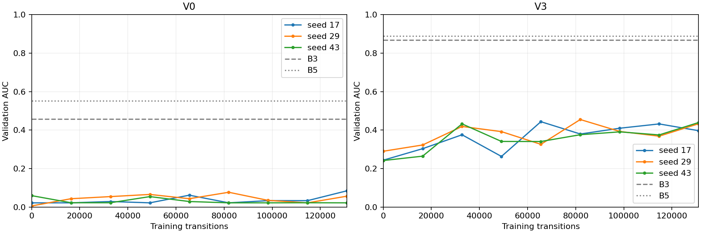

# M8 PPO validation

Completed training runs: 6/6.

These are checkpoint-selection results on B, not held-out test performance. All training seeds are reported. Paired intervals resample worlds after selection; they do not correct selection bias or shared imagery.

| Variant | Seed | Selected step | AUC | Found | All found | False declarations | Zero-p AUC | Zero-p minus B2 |
|---|---:|---:|---:|---:|---:|---:|---:|---:|
| V0 | 17 | 131072 | 0.085 | 0.100 | 0.050 | 1.38 | 0.099 | -0.358 |
| V0 | 29 | 81920 | 0.077 | 0.087 | 0.075 | 1.25 | 0.066 | -0.391 |
| V0 | 43 | 49152 | 0.055 | 0.062 | 0.050 | 1.23 | 0.055 | -0.402 |
| V3 | 17 | 65536 | 0.444 | 0.454 | 0.300 | 0.38 | 0.479 | -0.200 |
| V3 | 29 | 131072 | 0.433 | 0.446 | 0.275 | 0.65 | 0.410 | -0.269 |
| V3 | 43 | 131072 | 0.439 | 0.452 | 0.300 | 0.50 | 0.483 | -0.196 |

## Across-seed comparison

| Variant | Completed seeds | Mean AUC | Seed standard deviation | B3 AUC | B5 AUC |
|---|---:|---:|---:|---:|---:|
| V0 | 3 | 0.072 | 0.016 | 0.457 | 0.551 |
| V3 | 3 | 0.439 | 0.005 | 0.868 | 0.888 |

Zero-belief diagnostic gate: True. A positive zero-p minus B2 triggers investigation; it must not be silently accepted.

## Behaviour and stability

| Variant | Seed | Mean first find (s) | Seconds at L1/L2/L3/L4/L5 | Immediate descents / coarse detections | Final three AUC range |
|---|---:|---:|---|---:|---:|
| V0 | 17 | 436.9 | 449.6/8.7/7.6/10.3/2.0 | 40/40 | 0.051 |
| V0 | 29 | 455.5 | 435.1/9.3/9.2/11.0/2.7 | 39/42 | 0.035 |
| V0 | 43 | 467.2 | 449.6/8.7/7.6/10.3/2.0 | 40/40 | 0.000 |
| V3 | 17 | 231.8 | 0.0/0.0/0.0/0.0/353.4 | 0/831 | 0.035 |
| V3 | 29 | 222.0 | 0.0/0.0/0.0/0.0/365.2 | 0/1001 | 0.064 |
| V3 | 43 | 233.0 | 0.0/0.0/0.0/0.0/354.4 | 0/880 | 0.064 |
| V0 B3 | — | 202.8 | 16.8/20.1/22.0/188.4/95.1 | not logged in M7 | — |
| V3 B3 | — | 48.4 | 0.2/9.2/9.6/72.4/8.5 | not logged in M7 | — |

First-find times are censored at 500 s. Coarse-detection counts use raw cached views, including resolved/suppressed detections. The final-three range describes curve variation; it is not a convergence proof. Optimizer finiteness and per-world metrics are in the JSON; full trajectories remain in the local run archive.

The zero-p diagnostic retains prior, coverage, resolved cells and vector inputs. It is an input-removal check, not a separately trained prior-only policy.

