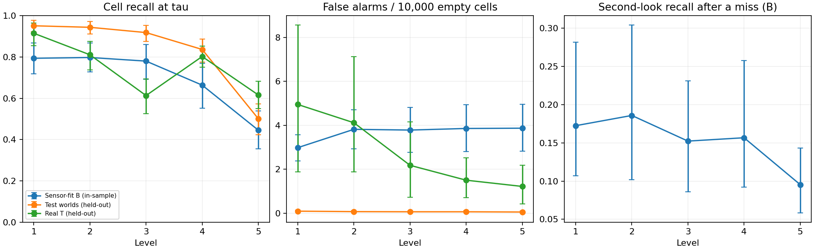
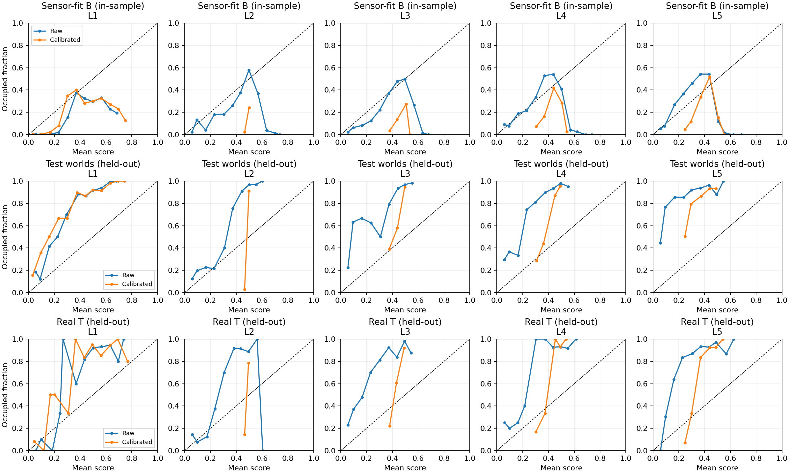

# M6 sensor results

Model `fcf8cdae58ca3947`; detector `700e0ff3455259e8`; fit world set `5dc45d0e1ea5afbd`.

Reproduce with `scripts/report_sensor_models.py --model <model.json> --real <real-T/report.json>`. Protocol: [sensor-protocol.md](sensor-protocol.md).

Rates below are raw estimates with 95% cluster-bootstrap intervals. Runtime likelihoods use the fixed smoothing documented in the protocol. False alarms are per 10,000 observed empty cells, including distractor cells.

## Sensor-fit B (in-sample)

| Level | Recall at tau [95% CI] | False alarms / 10k [95% CI] | Detected cells at tau_min | ECE raw → calibrated | BCE raw → calibrated |
|---|---|---|---:|---|---|
| L1 | 0.794 [0.718, 0.868] | 2.985 [2.387, 3.576] | 5529 | 0.169 → 0.162 | 0.541 → 0.534 |
| L2 | 0.797 [0.727, 0.868] | 3.819 [2.928, 4.717] | 4609 | 0.284 → 0.263 | 0.777 → 0.693 |
| L3 | 0.780 [0.692, 0.861] | 3.785 [2.775, 4.809] | 4092 | 0.258 → 0.259 | 0.742 → 0.690 |
| L4 | 0.664 [0.551, 0.769] | 3.858 [2.813, 4.936] | 3935 | 0.272 → 0.246 | 0.722 → 0.682 |
| L5 | 0.446 [0.356, 0.538] | 3.870 [2.823, 4.955] | 3500 | 0.310 → 0.285 | 0.705 → 0.673 |

## Test worlds (held-out)

| Level | Recall at tau [95% CI] | False alarms / 10k [95% CI] | Detected cells at tau_min | ECE raw → calibrated | BCE raw → calibrated |
|---|---|---|---:|---|---|
| L1 | 0.951 [0.922, 0.978] | 0.092 [0.046, 0.141] | 2488 | 0.380 → 0.366 | 0.606 → 0.589 |
| L2 | 0.943 [0.910, 0.972] | 0.072 [0.031, 0.119] | 2354 | 0.426 → 0.415 | 0.681 → 0.691 |
| L3 | 0.918 [0.876, 0.954] | 0.065 [0.027, 0.111] | 2165 | 0.460 → 0.429 | 0.745 → 0.698 |
| L4 | 0.836 [0.776, 0.887] | 0.064 [0.023, 0.112] | 2110 | 0.458 → 0.406 | 0.789 → 0.709 |
| L5 | 0.501 [0.424, 0.573] | 0.053 [0.016, 0.100] | 1594 | 0.538 → 0.461 | 1.018 → 0.800 |

## Real T (held-out)

| Level | Recall at tau [95% CI] | False alarms / 10k [95% CI] | Detected cells at tau_min | ECE raw → calibrated | BCE raw → calibrated |
|---|---|---|---:|---|---|
| L1 | 0.915 [0.855, 0.965] | 4.950 [1.886, 8.568] | 138 | 0.329 → 0.323 | 0.608 → 0.600 |
| L2 | 0.810 [0.738, 0.874] | 4.118 [1.881, 7.134] | 187 | 0.369 → 0.290 | 0.686 → 0.688 |
| L3 | 0.613 [0.526, 0.694] | 2.180 [0.727, 4.162] | 214 | 0.410 → 0.322 | 0.838 → 0.696 |
| L4 | 0.802 [0.750, 0.853] | 1.503 [0.701, 2.527] | 219 | 0.448 → 0.414 | 0.785 → 0.705 |
| L5 | 0.616 [0.550, 0.683] | 1.218 [0.427, 2.188] | 244 | 0.458 → 0.399 | 0.839 → 0.726 |

## Re-look and level-design check (B only)

| Level | Temperature | P(hit second / missed first), tau [95% CI] | Same, tau_min [95% CI] | Full lattice sweep (s) |
|---|---:|---|---|---:|
| L1 | 0.744 | 0.172 [0.107, 0.282] | 0.100 [0.020, 0.333] | 542.0 |
| L2 | 19.864 | 0.186 [0.102, 0.304] | 0.184 [0.083, 0.333] | 278.0 |
| L3 | 5.284 | 0.152 [0.086, 0.231] | 0.131 [0.050, 0.252] | 170.0 |
| L4 | 3.157 | 0.157 [0.092, 0.258] | 0.175 [0.093, 0.311] | 122.0 |
| L5 | 2.461 | 0.095 [0.058, 0.143] | 0.151 [0.069, 0.291] | 78.0 |

Each second-look measurement pools all ordered distinct variant pairs at the same viewpoint; intervals resample worlds. It does not prove independence across overlapping views. The default remains one informative observation per cell/level (D35).

The owner retained the five levels and 500 s battery (D35). L1's cell recall is slightly below the original 0.80 target; its interval includes 0.80. L5 is below the revised 0.65 target. Fine coverage exceeds the battery; coarse coverage costs less than one quarter. Rates are cell events, not D24's 1 m object-level recall.

## Calibration limitations

Temperature scaling is fit by BCE, so ECE need not decrease. A positive temperature cannot move a raw score across 0.5 or change score ordering. The remaining calibration error is reported without refitting on T. B worlds include distractors; test worlds contain none, which changes the prevalence of true cells among detections. Real T consists of exercise scenes and has different context and density again. Detection-score calibration is not a transferable occupancy posterior; V3 uses conditional likelihoods and a separate prior.

There are 40 fit worlds and 80 test worlds, ten per family. World bootstrap intervals do not capture uncertainty from having only one source day per split or repeated imagery across worlds; frame intervals likewise do not capture between-video/day variation. Simulation only.

